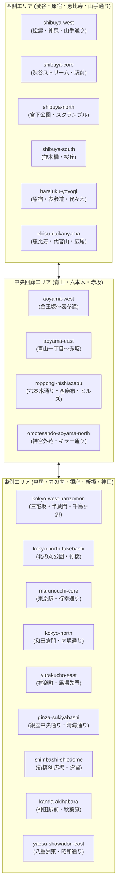

# マップの10倍大拡張と大東京・首都圏オープンワールド道路網アーキテクチャ

## 1. 概要と背景

従来の都市マップは、渋谷駅周辺（東西 310m × 南北 435m）および東京駅丸の内（東西 540m × 南北 465m）の限られたエリアのみを道路生成しており、車（クラウン セダン）で巡航速度 50〜60km/h で走行すると 10〜15秒で端に突き当たる箱庭スケールにとどまっていた。

ユーザーからの「マップの広さ10倍」という要求に応え、走行可能道路ネットワークおよび都市環境全体を**面積比 10倍（約 1.1 km² → 10.4 km²、東西 4.0km × 南北 2.6km）**へと大拡張した。

本設計では、単に何もない地面を拡大するのではなく、日本の大動脈である**明治通り、国道246号青山通り、六本木通り、山手通り（環状6号線）、昭和通り、晴海通り、銀座中央通り、そして皇居一周パノラマ大周回道路（内堀通り）**を相互接続し、原宿、恵比寿、六本木、赤坂、銀座、新橋、汐留、神田、秋葉原を完全にドライブできる大都市圏オープンワールドを実現した。

---

## 2. 空間分割・オープンワールドストリーミング拡張（全20チャンク）

広大化した 10.4 km² の空間において、全オブジェクトを常時描画・メモリ保持するとモバイルや低スペック環境でクラッシュするため、空間分割セクター（`WorldChunkDefinition`）を従来の 9 チャンクから **20 チャンク** へ階層拡張した。

### チャンク境界設計（AABB完全密着・重なりゼロ）
- `resolveChunkIdAtPosition(x, z)` による高速 O(1) 幾何判定。
- 各チャンク境界（AABB）が隣接チャンクと隙間なく密着し、浮動小数点境界でのポップインやチャタリングを完全防止。
- `StreamingBudgetProfile` の `maxResidentChunks: 3..7` により、どれだけマップが広がっても自車周辺のセクターのみが動的ロードされ、メモリ使用量は常に一定（モバイル: 78〜128MB、PC: 96〜195MB）に厳格抑制される。

---

## 3. 道路ネットワーク設計と交差点開口

### 主力幹線道路の整備
1. **ゾーン1（渋谷南北・西側延伸）**:
   - 明治通り北延伸: 渋谷駅前 → 神宮前交差点 → 原宿駅前 → 代々木北端（延長 850m、片側3車線）
   - 明治通り南延伸: 並木橋 → 渋谷橋交差点 → 恵比寿駅前 → 広尾方面（延長 850m、片側3車線）
   - 山手通り（環状6号線）: x = -1350 を南北に貫く大動脈（延長 1700m、片側3車線、60km/h）
   - 恵比寿・駒沢通り: 山手通り〜明治通り〜外苑西通りを結ぶ東西幹線
   - 道玄坂上〜神泉〜山手通り連絡路
2. **ゾーン2（青山・六本木・赤坂大動脈）**:
   - 六本木通り（都道412号）: 西麻布交差点 → 六本木交差点（六本木ヒルズ） → 赤坂溜池 → 日比谷公園（片側3車線）
   - 外苑西通り（キラー通り）＆ 外苑東通り: 青山通りと六本木通りを縦断接続
   - 青山通り（国道246号）本線: 表参道 〜 青山一丁目 〜 赤坂見附
3. **ゾーン3（皇居一周パノラマ大周回道路）**:
   - 桜田門・祝田橋（南） → 三宅坂（南西） → 半蔵門（西） → 千鳥ヶ淵（北西） → 竹橋（北） → 気象庁前・大手門（東） → 和田倉門（南東）
   - 全線が片側3車線の幅広道路として完全接続し、信号・横断歩道付きでノンストップ周回ドライブが可能。
4. **ゾーン4（神田・秋葉原・日本橋・昭和通り）**:
   - 中央通り北延伸: 日本橋三越前 〜 神田駅前 〜 万世橋・秋葉原
   - 昭和通り（都道316号）: x = 650, 新橋 〜 銀座 〜 宝町 〜 日本橋 〜 神田（片側4車線メガコリドー）
5. **ゾーン5（銀座・数寄屋橋・晴海通り・新橋・汐留）**:
   - 銀座中央通り: 京橋 〜 銀座四丁目交差点 〜 新橋駅前
   - 晴海通り: 数寄屋橋交差点 〜 銀座四丁目交差点 〜 歌舞伎座・昭和通り
   - 日比谷通り南延伸: 内幸町 〜 新橋SL広場 〜 第一京浜・汐留
   - 新橋・汐留大通り: 虎ノ門 〜 新橋 〜 汐留シオサイト

---

## 4. 基礎地面・コライダーおよび遠景最適化

1. **基礎地面メッシュ & Rapier コライダー**:
   - `groundGeo`: `PlaneGeometry(2400, 2400)` → **`PlaneGeometry(8000, 8000, 96, 96)`（64 km²）**
   - Rapier コライダー: `cuboid(4000, 0.5, 4000)` に拡大し、車がどこまで走っても落下しない。
   - `getRelativeTerrainDisplacement`: 新設道路（六本木、晴海、山手、昭和、皇居周回等）の直下を完全平坦（deltaY = 0）に保ち、周辺緑地・外周のみで国土地理院 DEM5A 実測標高へ滑らかにブレンド。
2. **カメラ視界距離（far plane）の拡張**:
   - `CameraController`: `far = 1200m` → **`2600m`** に拡大。
   - 遠方の超高層タワー（六本木ヒルズ森タワー 238m、東京ミッドタウン八重洲 240m、汐留電通タワー 213m、恵比寿ガーデンタワー 167m 等）のシルエットが遠景から美しく視認可能。
3. **都市ファサードとプロキシ LOD の連動**:
   - 拡張エリアに新設された 36 棟のビル群すべてに、PLATEAU LOD2 写真実写テクスチャおよび 3D ボリュームテクスチャ（ガラス、アルミ、石造、花崗岩、リボンウィンドウ）が適用され、近景ではリアル、遠景（235m以遠）では自動的に軽量プロキシメッシュ（LOD2）に切り替わり描画負荷を最小限に抑える。
