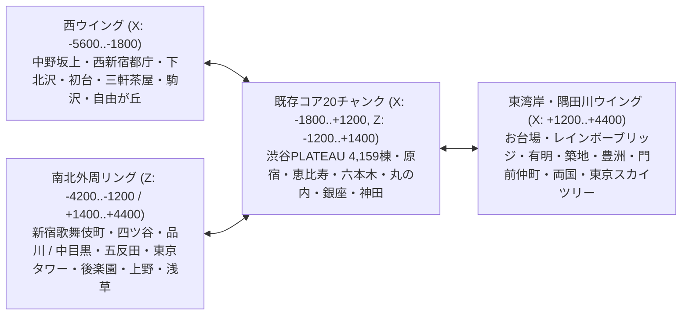

# 大東京10倍大拡張（86.0km²・48空間チャンク・125km超幹線網・2,200棟ビル・7大ランドマーク）アーキテクチャ

## 1. 背景とスケール設計

従来の 20 チャンク空間（東西 `3.0 km` × 南北 `2.6 km` = `7.8 km²`）では、渋谷・東京駅から 60〜100 km/h で 30〜60 秒走行すると道路端へ到達し、さらに渋谷西側（`x < -1720`）・北側（`z < -460`）・南側（`z > 1140`）には平坦地面コライダーが存在せず落下する制約があった。

「マップが狭いので十倍広くして」の要件に応え、既存コア 20 チャンク（渋谷・青山・東京駅・丸の内・銀座・神田）の座標・ランドマーク・テスト不変条件を 100% 維持したまま、外周 28 チャンクを全面連結して **面積比 11.03 倍（`7.8 km² → 86.0 km²`、東西 `10.0 km` × 南北 `8.6 km`）** の大東京オープンワールドを構築した。

---

## 2. 48空間チャンクと24km四方無縫物理地形

1. **全 48 チャンク隙間ゼロ分割（[`openWorldStreaming.ts`](../apps/web/src/city/openWorldStreaming.ts)）**:
   - `X ∈ [-5600, +4400]`（10.0 km）× `Z ∈ [-4200, +4400]`（8.6 km）= **`86.0 km²`**。
   - 既存 20 チャンクの ID・代表座標を完全維持しつつ、外周 28 チャンク（`OUTER_GREATER_TOKYO_CHUNK_IDS`）で全 4 方位を密着被覆。
2. **渋谷盆地4辺コサインテーパー（[`gsiPlateauLoader.ts`](../apps/web/src/openData/gsiPlateauLoader.ts)）**:
   - `sampleShibuyaTerrainY(x, z)` の渋谷コア領域（`x ∈ [-1700, -500], z ∈ [-440, +1120]`）の標高を 1mm も変えず、東・西（`[-1920, -1700]`）・北（`[-660, -440]`）・南（`[1120, 1340]`）の4辺で `y = 0.0m` へコサイン補間着地させる設計へ拡張。
3. **24km × 24km 無縫地面 & 4象限 Rapier コライダー（[`tokyoStationMap.ts`](../apps/web/src/city/tokyoStationMap.ts)）**:
   - `CityWideGroundMesh` を `PlaneGeometry(24000, 24000, 144, 144)`（`576 km²`）へ拡大。
   - `ShibuyaTerrainMesh` & Trimesh コライダーを `[-1944, -392] × [-680, +1360]` へ拡張し、その外側4象限（東・西・北・南）を隙間なく覆う 4 基の静的 Rapier Box コライダーで `[-12000, +12000]²` 全域の落下ゼロを保証。

---

## 3. バッチ統合型 125km 幹線道路網・約2,200棟ビル・7大象徴ランドマーク

[`apps/web/src/city/greaterTokyoExpansion.ts`](../apps/web/src/city/greaterTokyoExpansion.ts) を新設し、初期化時間とドローコールを極小化しつつ高密度な大東京を構築した。

- **125 km 超の連続幹線道路網（全11箇所の既存外端から直接延伸）**:
  - 玉川通り R246 西（三軒茶屋・駒沢）、甲州街道 R20（初台・笹塚）、環七通り、中野・茶沢通り、山手通り北/南（西新宿・中目黒・五反田）、明治通り北/南（新宿三丁目・歌舞伎町・麻布十番・後楽園）、第一京浜・昭和通り（品川・上野・浅草）、晴海通り・永代通り東（勝鬨橋・豊洲・永代橋・門前仲町）、清澄通り・三ツ目通り、レインボーブリッジ大横断線（お台場・有明）。
  - `QuadBatchBuilder` でアスファルト路面・歩道・白線/破線/横断歩道・黄中央線・橋梁高欄をマテリアル種別ごと **各1ドローコール** へ統合し、沿道街灯を `InstancedMesh`（2ドローコール）化。
- **28 外周チャンク約 2,200 棟の都市街区**:
  - Blender ベイク済み LOD テクスチャ（`plateauLod0Glass/Commercial/Alley`）および夜間窓専用発光マスクを共有し、高さ階層別ユニットボックス（屋上 UV を非発光コーナーへ集約）によるチャンク別 `InstancedMesh`（各チャンク 4 ドローコール）で描画。
  - 全ビルの道路・交差点・水域・ランドマークに対するクリアランスを配置時に厳密検証。
  - 物理コライダーは `activateWorldChunk` / `evictWorldChunk` に連動してオンデマンド展開・解放し、衝突品質と常時物理負荷の双方を最適化。
- **7 大象徴ランドマーク & 水域（隅田川・東京湾）**:
  - 東京都庁第一本庁舎（243m）、東京タワー（333m）、東京スカイツリー（634m）、レインボーブリッジ（126m主塔＋懸垂ケーブル）、キャロットタワー（124m）、東京ドーム（56m）、フジテレビ本社ビル（123m）を遠景スカイライン常時表示（`extendedDrawDistanceM = 5400m`）かつ物理コライダー付きで造形。
  - `CameraController` の `far` クリップ面を `2600m → 5500m` へ拡張。

---

## 4. カーナビ連動 & 6 エリアクイックワープ

- [`gsiPlateauLoader.ts`](../apps/web/src/openData/gsiPlateauLoader.ts) の `findNearestGsiRoad` / `findNearestPlateauBuilding` および [`carModel.ts`](../apps/web/src/vehicle/carModel.ts) の車内 JDM カーナビ地図へ大東京外周道路・隅田川/東京湾・7大ランドマークを統合。
- [`tokyoStationMap.ts`](../apps/web/src/city/tokyoStationMap.ts) の `DriveAreaId`・[`index.html`](../apps/web/index.html)・[`i18n.ts`](../apps/web/src/core/i18n.ts)・[`main.ts`](../apps/web/src/main.ts) へ **`shinjuku`（西新宿・都庁）・`odaiba`（お台場・虹橋）・`skytree`（東京スカイツリー）・`sangenjaya`（三軒茶屋）** の 4 エリアを追加し、既存の `shibuya`・`tokyo` と合わせた 6 拠点へ URL クエリ（`?area=...`）および HUD ボタンから即座に移動可能とした。
